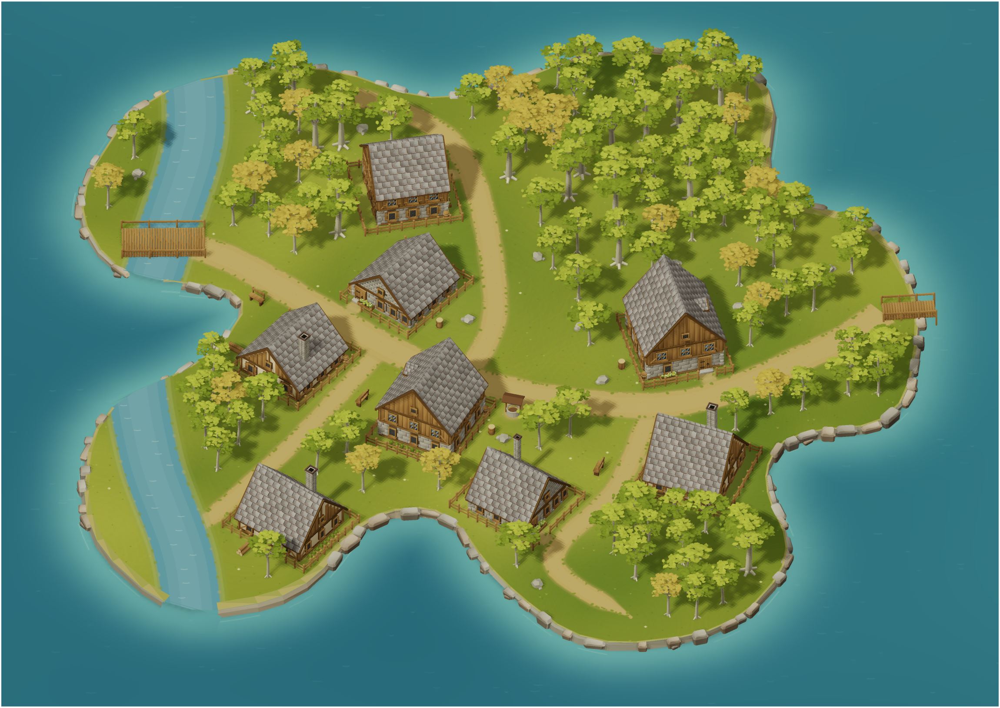
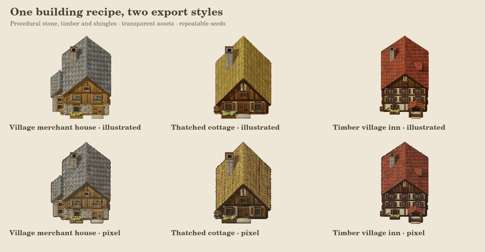
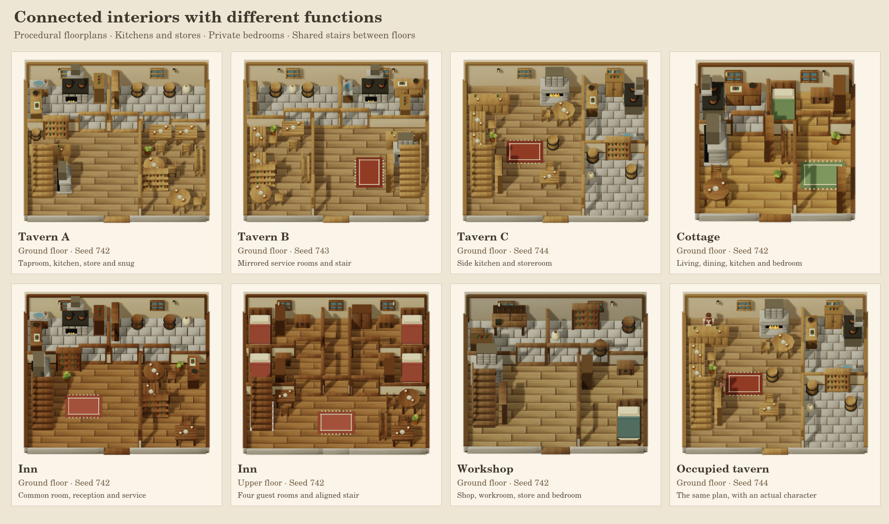
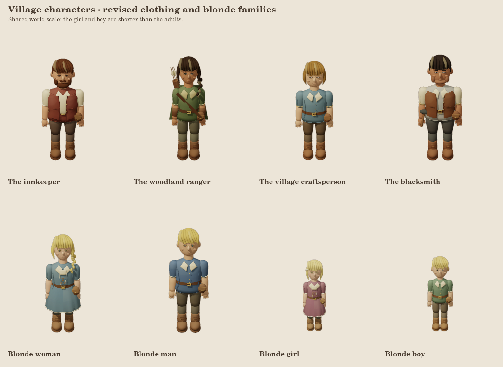
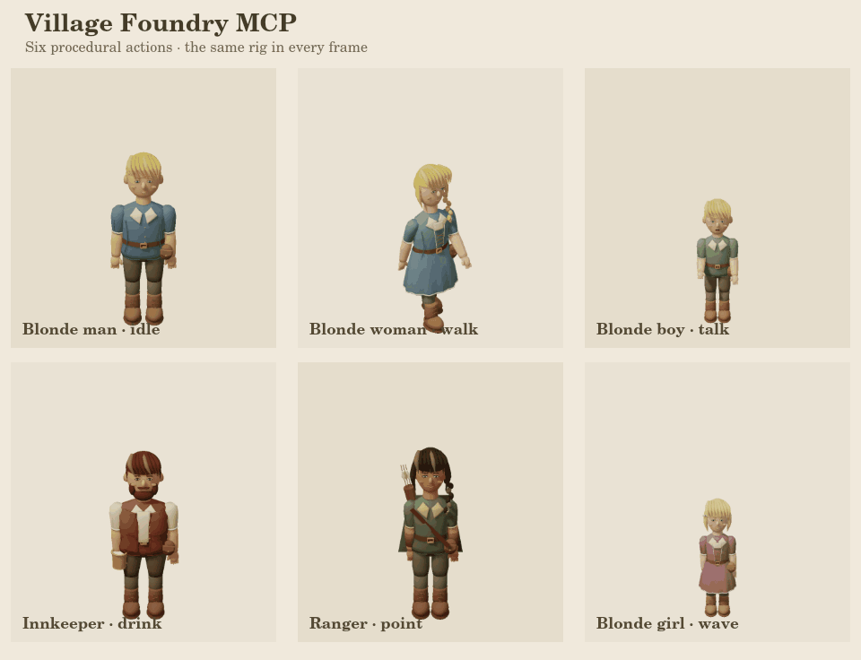
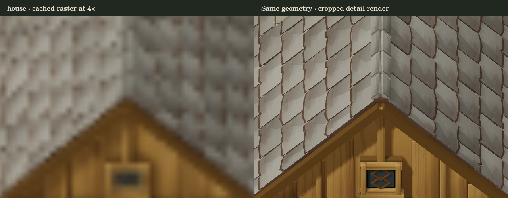

# Village Foundry MCP

A browser workbench for **illustrated or pixel-style 2D houses, interiors, village maps, and animated characters**, built from procedural geometry, materials, and orthographic rendering. It uses local Three.js r180 modules. **Village Foundry MCP** exposes precise scene controls for connected assistants. There are no image AI models, image-generation APIs, or automatic image-to-3D reconstruction.

## See the generated worlds

These previews are rendered by the project’s procedural geometry and material code. They are included in `docs/media/`, so they continue to display when this folder is pushed to GitHub.



| Workbench | What it creates |
| --- | --- |
| Houses | Repeatable architectural families, adjustable dimensions, transparent PNGs and batches. |
| Interiors | Connected taverns, kitchens, stores, bedrooms, workshops and multiple floors. |
| Maps | Organic islands or mainland areas with roads, bridges, water, trees, fences and building links. |
| Characters | Eight starting presets, editable appearances, six actions, directional sprites and animation sheets. |
| MCP | The same scene and export controls through the local or hosted HTTP endpoint. |

### Illustrated and pixel finishes



### Rooms with different functions



### Characters and movement





The GIF uses actual rendered poses. Each action is sampled over one complete cycle and normalized to a 2.4-second loop for this overview; exported animation metadata retains the individual action durations and frame timing.

## Run locally on Windows or macOS

Download and extract the **complete project**, then install [Node.js](https://nodejs.org/) version **20 or newer**; a current LTS release is recommended. The browser renderer and Three.js files are included. Running the packaged local workbench does not require `npm install`, a cloud account, an API key, or an image model.

| System | Launch |
| --- | --- |
| Windows | Double-click **`start-local.cmd`**. |
| macOS | Double-click **`start-local.command`**. If Finder does not run it, open Terminal in the project folder and run `bash ./start-local.command`. |
| Windows, macOS, or Linux terminal | Run **`npm run local`** from the project folder. |

Keep the terminal window open, then open **http://127.0.0.1:8787** in a modern browser. The MCP endpoint is **http://127.0.0.1:8787/mcp**. Press **Ctrl+C** in the terminal to stop the server.

The equivalent command without npm is:

```bash
node scripts/local-server.mjs
```

To use another port or keep the scene data in a portable folder:

```bash
npm run local -- --port 9000 --data-dir ./local-data
```

The app and MCP endpoint then both use port 9000. `VILLAGE_FOUNDRY_PORT` can also set the port. The server binds to **127.0.0.1 only**; it is intended for clients on this computer and does not expose a network service to other machines.

### Local data and the browser renderer

The local service stores the saved scene and completed exports in a local data directory. The defaults are:

| System | Data directory |
| --- | --- |
| Windows | `%LOCALAPPDATA%\VillageFoundry` |
| macOS | `~/Library/Application Support/VillageFoundry` |
| Linux | `$XDG_DATA_HOME/village-foundry`, or `~/.local/share/village-foundry` when that variable is unset |

Use `--data-dir` to select another directory. Each local data directory represents one shared local scene/workspace. Browser recipes and MCP edits therefore refer to that same local scene when they synchronize.

**For MCP PNG exports, keep the local browser tab open with “Follow MCP changes” enabled in its MCP scene controls.** A successful local connection enables Follow automatically; it can also be toggled manually. The local server validates recipes, stores them, and queues immutable export jobs. The browser draws the geometry and uploads the transparent PNG back to the local server. A server running by itself does not render queued images. The published site's tab and the local tab use separate endpoints and storage.

### Connect Godot 4

[The runnable Godot example](examples/godot/README.md) uses `HTTPRequest` and JSON-RPC to list tools, create a house, queue an exact-size transparent PNG, poll `get_scene`, download the completed image, and save it under `user://generated`. It also shows how to use the exported ground-contact anchor when placing a `Sprite2D`.

Import `examples/godot/project.godot`, start the local server, enable **Follow MCP changes** in the local workbench, and run the Godot scene. The example deliberately replaces the current local scene with its sample house. Its default output is a **256 × 320** transparent PNG. Change `output_directory` to `res://generated` when creating assets inside an editable Godot project; exported applications should keep the writable `user://` location.

Godot is not assumed to provide a built-in universal MCP client. This example implements the small HTTP/JSON-RPC subset used by Village Foundry. It sends no authentication token or session header to the loopback server. See the [Godot HTTPRequest reference](https://docs.godotengine.org/en/stable/classes/class_httprequest.html) and [FileAccess reference](https://docs.godotengine.org/en/stable/classes/class_fileaccess.html) for the underlying APIs.

### Static preview only

For a browser-only preview without local MCP or saved server exports, `python3 -m http.server 8000 --directory dist` still works. Open http://localhost:8000. The Node launcher above supplies the local scene API and MCP endpoint as well as the workbench.

## Create scenes

**Houses** start from eight templates. The farm longhouse has a centered side entrance, the stone gatehouse has a crosswise roof, and the weaver’s townhouse has three narrow storeys. The village merchant house, red-roof stone house, cottage, inn, and manor are also available.

Under **Doors & windows**, choose a wall and place the door at its left, center, or right as viewed from outside. The steps and porch follow the door. Set each main wall to **Automatic** or choose **0–3 windows per floor**. Windows can be evenly spaced or grouped toward one end. Attic, dormer, and wing windows are separate architectural details. Under **Structure → Roof ridge**, choose a front-to-back or side-to-side ridge.

House batches export **1–500 sprites** with editable JSON recipes. Choose **Current house layout** to keep your door, window, and roof settings across the batch. Choose **Mixed village** to vary layouts across all eight templates.

**Interiors** start from a tavern, cottage, inn, or workshop. Recipes support dimensions from 6–20 world units, six layout families or seeded automatic selection, 0–6 bedrooms, and up to three floors. `floorIndex` is zero-based and must be below `floorCount`; use the same seed across a building's floors so the layout can align its stairs. Kitchens, stairs, and occupants have explicit switches; occupants default off. Furniture controls allow 0–12 tables and 0–12 extra beds, with bedrooms supplying their own beds. The room brief interprets explicit rules, while MCP can place supported furniture by ID and coordinates.

**Maps** start from an island village, market town, river settlement, or farmstead. Configure dimensions from 24–256 world units per side, up to 32 houses, roads, fences, trees, water, and gardens. Size shortcuts are Small (48 × 48), Medium (80 × 80), Large (128 × 128), and Huge (192 × 192); custom rectangular dimensions are supported. The default `landform: "island"` has a seeded coastline with bays and peninsulas, layered cliffs, coastal stones, beaches, and turquoise shallows that blend into surrounding sea. `sea: true` is the default; `sea: false` leaves transparency beyond a soft water fringe. `landform: "mainland"` supplies a rectangular terrain patch.

The visible coastline also defines the land predicate used by the village planner. Organic layouts connect paths to plots and entrances, and houses can use a selected architectural family or a coordinated mix. Houses can also be disabled to export the surroundings separately. Recipes retain the seed, feature controls, house count, landform, sea option, layout style, and palette. Placement remains subject to usable land and clearance; small or narrow maps can fit fewer than the requested houses, and the layout report gives the actual count and a capacity notice. Bridges are placed at actual road–river crossings and span the river according to the crossing angle. If the river and road network do not cross, no road bridge is added.

Larger maps preserve house dimensions and the half-unit walkability grid. Road-planning samples, vegetation attempts, and texture sizes are bounded; there are at most 150 generated trees and 32 houses. Rectangular terrain textures preserve world-space road widths. Export detail and final PNG dimensions remain separate from world-space map dimensions, so increasing map size alone does not increase every sprite's pixel detail.

**Characters** start from an innkeeper, ranger, villager, blacksmith, blonde woman, blonde man, blonde girl, or blonde boy. Gender (`female` or `male`), age (`adult` or `child`), height (1.05–2.00 world units), build, hairstyle, beard, and clothing colors are explicit recipe fields. Child recipes use child proportions and normalize the beard to `none`. The same character can idle, walk, talk, drink, point, or wave. Animation time, facing direction, and mouth pose can be adjusted independently of appearance. Character heights use the same world units as the houses and rooms.

To sample **material colors** from your own image, add it under **Reference image** and select **Use image colours**. Geometry comes from templates and scene recipes. Fresh procedural surface definitions provide stone, plaster, timber, roof, and room finishes. `painted-surfaces.mjs` adds restrained painted shading and wear to individual shingles, blocks, and boards; it does not repeat photographs across the model.

The default elevated view shows both the roof and façade. Orthographic camera elevation and rotation can be adjusted, including top and front views. **Illustrated** style uses smooth, higher-resolution rendering; **Pixel** style uses deliberate pixel edges. Recipes preserve the selected style.

Use the mouse wheel over the preview to zoom from **25% to 800%**. Hold **Shift** while dragging, or drag with the **middle mouse button**, to pan. **Fit** resets the preview zoom and position. These controls affect the preview only; they do not change scene dimensions, camera angles, or exported PNG framing. Illustrated previews redraw immediately while navigating, then render fresh geometry for the visible viewport when navigation settles. The same model, seed, materials, and lighting remain in use. Pixel previews retain their native pixel grid and nearest-neighbor display.

## PNGs, batches, and recipes

- House, interior, and character PNGs have transparent backgrounds. Island maps can include surrounding sea or leave transparent space beyond the shoreline. Automatic-size house, interior, and map exports trim unused margins. Character exports keep a shared frame box for stable pose anchors. Fixed-size exports retain the exact requested canvas with transparent padding.
- Rendering uses consistent pixels per world unit across a house batch. Bigger buildings may therefore produce bigger PNG dimensions.
- **Detail resolution** controls rendering detail rather than a fixed square output size. In **Illustrated 2D**, a larger **Export scale** increases native geometry sampling. In **Pixel Art**, it enlarges the original pixel grid by an integer factor. A fixed canvas has the final width and height requested.
- All still scene kinds support native detail settings up to **4,096**, including houses, interiors, maps, and character poses. Animation exports retain their 512 detail cap.
- Ground is a preview aid and is excluded from standalone house PNGs. A map's terrain is part of its scene. Material tiles have a separate export action.
- Save/load recipes retain explicit scene parameters. Repeatability depends on the recipe's template, seed, parameters, and material choices together.
- House batches include per-house PNGs and recipes plus a manifest. Individual interiors, maps, and character poses also use the PNG export pipeline.
- Character animation sheets use equal-sized cells: frames run across columns, facing directions down rows. Every frame samples the same character and one full animation cycle, with no duplicate endpoint. The shared frame box prevents a moving limb from shifting the character's anchor between frames.

### HD previews and native master PNGs

Illustrated zoom is a new render of the visible geometry, rather than a permanent enlargement of the small fitted preview. Rendering only the visible camera window keeps a close-up of a large island from allocating an enormous off-screen bitmap. Changes to preview magnification do not alter the saved recipe or crop the full-asset export.



The comparison above uses the same model and seed on both sides. The right side renders the visible camera window again, so roof edges, painted facets, and timber retain detail. Preview density is bounded by a viewport render budget; it does not allocate the entire island at the magnified size.

For a high-detail master, select **4096** under **Detail resolution**, use **Illustrated 2D**, and choose **1×** export scale. A connected MCP client can request the same render by sending this JSON-RPC body to its `/mcp` endpoint (`http://127.0.0.1:8787/mcp` by default locally), with `Content-Type: application/json`, after creating or loading a scene:

```json
{
  "jsonrpc": "2.0",
  "id": 2,
  "method": "tools/call",
  "params": {
    "name": "request_export",
    "arguments": {
      "options": {
        "resolution": 4096,
        "scale": 1,
        "style": "illustrated",
        "sizeMode": "auto"
      }
    }
  }
}
```

`resolution` controls native sampling density relative to the scene’s reference world span; it is not a promise of an exactly 4096-pixel-wide image. Choose a fixed canvas below when exact width and height matter. Save the recipe alongside the PNG to regenerate the same geometry at another density or camera angle. A PNG itself remains a finite raster image; the procedural scene is the source for further sharp renders. This release saves editable recipes, not GLB/FBX model files.

### Exact output sizes

Recipes and `request_export` options support `sizeMode: "fixed"`, `width`, `height`, `padding`, and `fit`. Width and height are the **final exported pixels**, between 16 and 8,192 each, with at most 33,554,432 pixels total. Padding is an integer from 0–128 and must be smaller than half either canvas dimension.

`fit: "contain"` fits the complete asset into that canvas with transparent padding while preserving its aspect ratio. Pixel-style containment retains an integer pixel grid and can render at a lower native resolution when needed. `fit: "pad"` retains the ordinary resolution and scale, adding transparent space; it fails when the sprite cannot fit instead of cropping it. Automatic sizing remains the default. Older recipes without these fields use `auto`, 512×512 stored target dimensions, padding 8, and `contain`.

Illustrated `scale` also increases native sampling; `1` is a useful starting point for a 4096-detail master because larger combinations can exceed the render budget. Illustrated containment renders enough native geometry detail for the target before fitting it. A request that exceeds the native render budget fails clearly instead of silently substituting a lower-resolution image. Pixel-style scale preserves and enlarges the original pixel grid.

The browser must remain open with **Follow MCP changes** enabled. Poll `get_scene`, then fetch the ready job's relative `url` from the same local origin. Native rendering is bounded to 8,192 pixels per side and 16,777,216 pixels per render. Final PNGs retain the 33,554,432-pixel limit, and MCP uploads retain the 16 MiB byte limit. Use 2,048 native detail or a smaller fixed canvas if a scene exceeds those bounds. HD still settings do not raise animation limits: animation snapshots cap inherited detail at 512 and reject explicit larger overrides.

## MCP scene control

Both the local server and authenticated deployment expose **`/mcp`**, with server name **`village-foundry-mcp`** and title **Village Foundry MCP**. Local clients use `http://127.0.0.1:8787/mcp`. For the published site, configure an authorized MCP client with that site's full endpoint URL. Use the matching workbench's **MCP scene controls** to load or send a house, interior, map, or character.

Enable **Follow MCP changes** and keep the tab open when requesting a PNG through MCP. The backend stores an immutable scene snapshot and export options; the browser renders them and uploads the resulting PNG. `get_scene` then reports its private download URL and output metadata. Only one different render request is pending at a time; retrying the same snapshot and options returns that pending job.

If the browser encounters a deterministic render-size or invalid-geometry error, the export job becomes `failed`. `get_scene` includes `exportJob.error.code` and `exportJob.error.message`; an MCP or Godot client can report that reason and request a new render with adjusted settings. Transient connection or upload failures remain retryable. A late upload cannot revive a failed or cancelled job.

Use `cancel_export` to clear a pending request that is no longer needed or cannot be rendered. Supplying its `id` and `expectedRevision` protects against cancelling a newer request. Completed PNGs are retained; already-ready or already-cancelled jobs return their existing state. A late upload cannot turn a cancelled job back into a completed one.

| Tool | Purpose |
| --- | --- |
| `list_templates` | Read all four kinds of templates, furniture types, animation durations, and limits. |
| `get_scene` | Read the saved scene, revision, layout report, and export status. |
| `generate_house` | Create a house from structured parameters. |
| `update_house` | Patch the current house's parameters. |
| `generate_map` | Create an island or mainland map with optional houses, sea, and landscape features. |
| `update_map` | Patch the current map's configuration. |
| `generate_character` | Create a character with explicit appearance and pose. |
| `update_character` | Patch the current character's appearance or pose. |
| `set_character_animation` | Set animation, time in seconds, direction in degrees, or mouth pose. |
| `generate_interior` | Create an interior floor from template, floor, layout, and furnishing settings plus an optional simple brief. |
| `update_interior` | Patch interior dimensions, floor selection, layout family, or furnishing controls. |
| `place_furniture` | Place or replace a furniture item using a stable ID and coordinates. |
| `remove_furniture` | Remove an explicit item or exclude a generated item by ID. |
| `request_export` | Queue a still PNG of any scene snapshot, optionally selecting resolution, scale, style, or exact canvas dimensions and fitting. |
| `request_animation_export` | Queue one character clip as a PNG sprite sheet with timing, direction, and cell metadata. |
| `cancel_export` | Cancel the latest pending render, optionally checking its ID and revision. |

Scene edits can include `expectedRevision` to detect concurrent changes. Update tools apply to their matching scene type; furniture tools require an interior and animation tools require a character. Recipes use the version 1 formats `house-foundry`, `house-foundry-interior`, `village-foundry-map`, and `village-foundry-character`. Render style is restricted to `illustrated` or `pixel`; arbitrary code is never accepted as a scene.

For example, call `generate_house` with these arguments for a longhouse with a centered right-side entrance, a transverse ridge, three front windows and one right-side window per storey.

```json
{
  "params": {
    "preset": "longhouse",
    "doorFace": "right",
    "doorPosition": "center",
    "roofRotation": 90,
    "windowCounts": { "front": 3, "right": 1 },
    "windowAlignment": "even"
  }
}
```

To edit that house, call `update_house` with `{"patch":{"windowCounts":{"right":0}}}` to clear the right wall’s main windows, or use `null` for that wall to restore automatic placement. Other walls keep their counts.

The interior furniture inventory includes tables, round tables, chairs, benches, stools, barrels, shelves, beds, chests, plants, rugs, bars, counters, stoves, sinks, workbenches, crates, sacks, cupboards, wardrobes, washbasins, and fireplaces. `list_templates` returns the current inventory and validated limits.

### Animation export contract

`request_animation_export` accepts `animation`, `frames` (4–24), `directions` (1, 4, or 8), `fps` (1–24), optional render `options`, and `expectedRevision`. Defaults are the current clip, 8 frames, 4 directions, and 8 fps. Sheets cap detail resolution at 512 and export scale at 2 to bound browser work. Inherited larger settings are reduced for that snapshot; explicit larger animation overrides are rejected.

Fixed output dimensions apply to **each cell**, with a maximum of 1,024×1,024 pixels per cell. The requested layout is checked before queuing: the complete sheet must fit within 16,384 pixels per side and 40 million pixels total. All PNG uploads retain a 16 MiB byte limit. Still-image uploads retain their separate 8,192-pixel side and 33,554,432-pixel area limits.

Pending `exportJob.options` supplies `format: "spritesheet"`, frame and direction counts, row and column counts, direction angles, cycle duration, playback duration, and exact sample times. Sampling uses `cycleDuration × frameIndex / frames`; fps determines the sheet's playback speed. Four directions are 0°, 90°, 180°, and 270°; eight add the intermediate 45° angles. A single direction retains the character's current facing angle. Zero faces positive Z.

The browser posts the PNG to `/api/exports/<job-id>`. Its dimensions must divide evenly into the requested columns and rows; fixed-size outputs must also match the requested cell or canvas dimensions exactly. It may include both `X-Foundry-Anchor-X` and `X-Foundry-Anchor-Y` as finite pixel coordinates within one cell. Completed `exportJob.metadata` contains the cell size and shared anchor, or a null anchor if none was supplied. PNG bytes and completed metadata are immutable. Still-image jobs use `options.format: "png"` and the same authenticated upload route.

The browser can cancel through `POST /api/exports/<job-id>/cancel`, with an empty body or JSON `{ "expectedRevision": 123 }`. The response contains the usual scene state plus `cancelled` and a readable `note`. Cancellation uses the same owner checks, origin validation, and conditional writes as other state changes.

On the hosted deployment, saved scenes and PNGs are scoped to the authenticated owner. That backend requires the trusted Sites authentication gateway and an R2 binding named **`BUCKET`**; it has no anonymous state fallback. The loopback-only local adapter supplies its own fixed local workspace and filesystem storage instead. It does not weaken the hosted authentication path. Reference uploads remain in the browser.

## Build the authenticated deployment

```bash
node scripts/build-worker.mjs
```

This embeds static assets, the shared DOM-free house/interior/map/character schemas, and the room director into `dist/server/index.js`. Run it again after changing frontend files. Deployment tooling supplies hosting configuration, authentication, and the R2 binding.

The local server uses Node built-ins and the browser uses vendored Three.js files. The main unit and HTTP integration checks need no package installation:

```bash
npm test
```

The optional offline render/demo scripts also need `@napi-rs/canvas`; the ZIP verification helpers use Python 3. Install those only when regenerating rendered examples outside the browser. Normal local use does not need them.

## Package or publish the source on GitHub

The project archive contains the complete editable source, the local launchers, the Godot example, this README, and its PNG/GIF media. It excludes deployment identity, Git history, dependencies installed in `node_modules`, generated Worker bundles, editor caches, and local scene/export data.

To build a fresh source archive after editing:

```bash
npm run package:project
```

The verified ZIP is written to `artifacts/village-foundry-mcp-project.zip`, with a companion manifest. Its internal `SOURCE_MANIFEST.json` records source file hashes and modes, including the executable macOS launcher.

To publish an extracted copy to a GitHub repository you own:

```bash
git init
git add .
git commit -m "Initial Village Foundry MCP"
git branch -M main
git remote add origin YOUR_GITHUB_REPOSITORY_URL
git push -u origin main
```

## License

The original Village Foundry MCP code and documentation are available under the [MIT License](LICENSE).
Three.js retains its [upstream MIT notice](dist/vendor/THREE_LICENSE.txt).
The supplied PNG tiles listed in the [material source inventory](dist/assets/materials/sources.json) are outside the scope of the project license.

## Geometry

For a symmetrical pitched roof with width `W` and pitch angle `θ`:

```text
roof rise = (W / 2) × tan(θ)
```

Walls, roof pieces, beams, windows, and furniture are positioned from explicit dimensions and placement rules. Orthographic projection maps those world positions onto the camera's axes without perspective shrinking. Views come from the actual geometry, rather than stretching a flat source image.

## Source map

| File | Responsibility |
| --- | --- |
| `dist/index.html`, `dist/style.css` | Responsive workbench interface. |
| `dist/app.js` | Controls, recipes, previews, exports, and MCP synchronization. |
| `dist/house-model.mjs` | House templates, seeded variation, and geometry. |
| `dist/house-schema.mjs` | Shared house parameters and template validation. |
| `dist/interior-model.mjs` | Connected room geometry, furniture, and floor details. |
| `dist/interior-floorplan.mjs` | Seeded room partitions, door connections, circulation, and aligned stairs. |
| `dist/interior-schema.mjs` | Shared interior configuration and limits. |
| `dist/map-schema.mjs` | Shared map templates, feature controls, and palette. |
| `dist/map-model.mjs` | Procedural terrain, village features, and optional house placement. |
| `dist/island-landscape.mjs` | Shared land boundary, shoreline predicates, cliff geometry, coastal stones, beach, water fringe, and sea backdrop. |
| `dist/character-schema.mjs` | Shared character appearance, pose validation, and clip durations. |
| `dist/character-model.mjs` | Articulated character geometry and procedural animation poses. |
| `dist/director.mjs` | Small deterministic layout-brief parser. |
| `dist/layout-report.mjs` | Compact placement reports for the private MCP scene API. |
| `dist/materials.mjs`, `dist/painted-surfaces.mjs` | Procedural finishes and individual painted surfaces. |
| `dist/renderer.mjs` | Orthographic rendering and transparent sprite preparation. |
| `dist/zip.mjs` | Browser-side ZIP packaging. |
| `src/worker.mjs` | Authenticated scene API, MCP tools, private exports, and static serving. |
| `scripts/local-server.mjs`, `scripts/local-storage.mjs` | Loopback HTTP/MCP server and persistent local storage. |
| `scripts/package-project.mjs` | Portable GitHub-ready source archive. |
| `examples/godot/` | Runnable Godot HTTP/JSON-RPC and PNG download example. |
| `docs/media/` | Actual generated PNG and GIF previews used by this README. |
| `scripts/build-worker.mjs` | Self-contained Worker build. |
| `start-local.cmd`, `start-local.command` | Windows and macOS launch wrappers. |
| `dist/vendor/` | Local Three.js modules and license. |

## Artistic limits

The result is a stylized, generated approximation with editable geometry and materials. It does not automatically reproduce a reference's exact architecture, hand-painted lighting, or painterly detail, and it is not a photoreal reconstruction. A closer art-direction match requires changes to templates, meshes, surface painting, lighting, or renderer settings.
